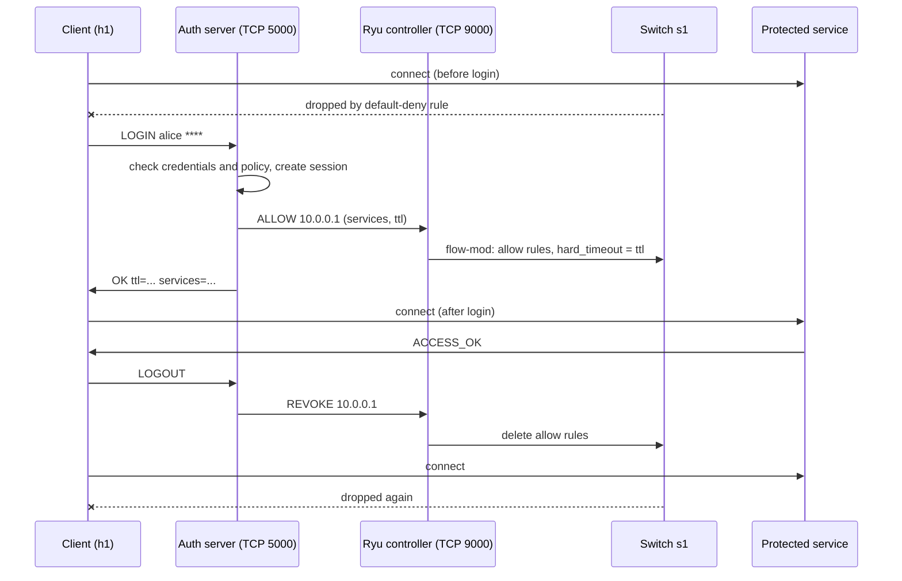
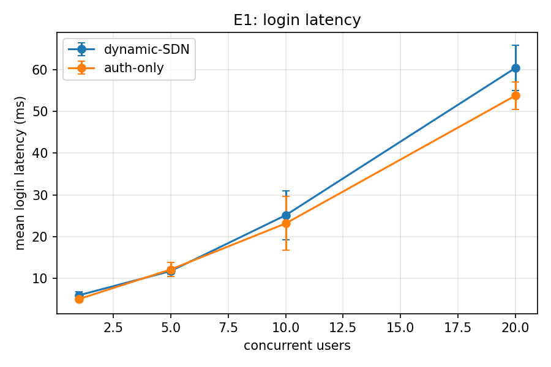
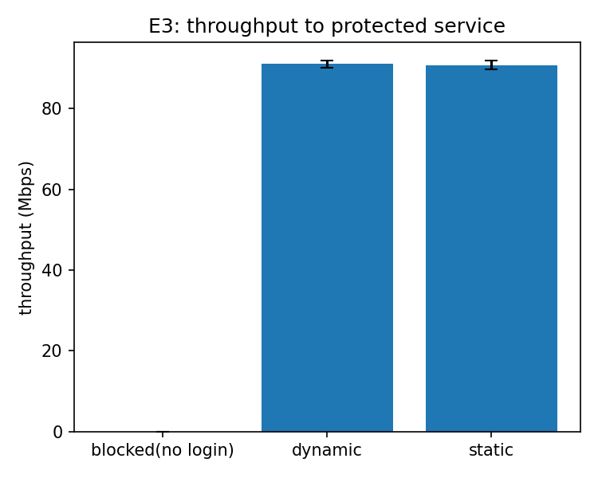

# Authentication and Network Access Control using TCP Sockets and SDN

**Course project:** SDN-Socket Programming, Jackfruit Mini Project
**Environment:** Mininet + Open vSwitch + Ryu (OpenFlow 1.3) + Python 3 TCP sockets, Ubuntu on VMware (Apple Silicon host)

## Team

- Dhruv
- Tanay
- Vishesh

---

## 1. Problem statement and objectives

Hosts on the network must authenticate before they can use a protected service. A TCP authentication server checks credentials, and the SDN controller dynamically grants, restricts or revokes network access for that host.

Objectives (from the project brief):

1. Implement a TCP authentication server and clients.
2. Support multiple concurrent users.
3. Maintain authentication sessions and timeouts.
4. Implement allow/deny access policies.
5. Dynamically install and remove SDN rules.
6. Maintain authentication and access logs.
7. Test authorized and unauthorized access scenarios.

Expected network behaviour: a client can always reach the authentication server, but traffic from a client to the protected service is dropped by default. After a successful login the controller opens exactly the allowed paths for that client. On logout, session expiry, or a brute-force block, the controller removes or overrides those rules.

---

## 2. Architecture

### Components

| Component | Role |
|---|---|
| Clients `h1`, `h2`, `h3` (10.0.0.1 to 10.0.0.3) | Run the auth client and the service client |
| Auth server host (`auth`) | Python multi-threaded TCP server on port 5000. Checks credentials, keeps sessions, counts failures, logs events |
| Protected service host (10.0.0.200) | Simple TCP services on ports 8080, 9090 and 7070 |
| Switch `s1` (Open vSwitch) | Enforces the flow rules |
| Ryu controller (`AclController`) | Installs default-deny rules, and installs or removes rules on request from the auth server. Control listener on TCP port 9000 |
| NAT node (10.0.0.254) | Lets hosts reach the controller listener running on the VM |

### Communication flow



The point where the socket application meets the SDN network is the message from the auth server to the controller (`ALLOW`, `REVOKE`, `BLOCK`). Application events (login, logout, repeated failures) directly change the flow table.

### Flow table design (table 0)

| Priority | Match | Action | Purpose |
|---|---|---|---|
| 200 | `ip, nw_src=<blocked host>` | drop (hard_timeout 30 s) | Brute-force block, overrides everything below |
| 100 | `tcp, nw_src=<client>, nw_dst=10.0.0.200, tp_dst=<port>` (and the reverse direction) | goto table 1 (hard_timeout = session TTL) | Per-session, per-service allow |
| 50 | `ip, nw_dst=10.0.0.200` | drop | Default deny for the protected service |
| 0 | anything else | goto table 1 | Table-miss, continues to the learning switch |

Table 1 is a learning switch, so ARP and client-to-auth-server traffic work normally. A higher priority always wins, which is why the allow rules (100) override the default deny (50), and the block rule (200) overrides the allow rules.

---

## 3. Application protocol

Text lines over TCP, terminated by a newline (the newline is the message delimiter, since TCP is a byte stream).

| Direction | Message | Replies |
|---|---|---|
| Client to auth server | `LOGIN <user> <password>` | `OK ttl=<s> services=<ip:port;...>` or `DENY <reason>` |
| Client to auth server | `LOGOUT` | `OK bye` or `ERR not-logged-in` |
| Auth server to controller | allow a host (IP, services, ttl) | rules installed |
| Auth server to controller | revoke a host (IP) | rules deleted |
| Auth server to controller | block a host (IP, seconds) | priority-200 drop rule |

Deny reasons seen in testing: `bad-credentials`, `no-access-policy`, `too-many-failures blocked 30`.

### Access policy

| User | Allowed services |
|---|---|
| alice | 8080, 9090, 7070 |
| bob | 8080 only |
| mallory | none (valid account, login denied with `no-access-policy`) |

### Server behaviour

- One thread per client connection, so several users can log in at the same time.
- Sessions are tracked per user and source IP, with an expiry time. A background thread expires old sessions.
- Failed logins are counted per source host. After 3 failures the host is blocked for 30 seconds.
- Every event is written to `logs/auth.log`. The controller writes `logs/controller.log` (`SWITCH_READY`, `ALLOW`, `REVOKE`, `BLOCK`, rule-removed events, dropped-packet counters).

(Implementation details are in `auth/auth_server.py` and `controller/acl_controller.py`.)

---

## 4. How to reproduce

### Install (Ubuntu)

```bash
sudo apt update
sudo apt install -y mininet openvswitch-switch python3-pip python3-matplotlib
sudo service openvswitch-switch start
sudo mn --test pingall            # should end with 0% dropped

pip install --user --break-system-packages uv
export PATH=$PATH:~/.local/bin
uv venv --python 3.9 ryuenv
uv pip install --python ryuenv/bin/python "setuptools==65.5.0" wheel pbr
uv pip install --python ryuenv/bin/python --no-build-isolation "eventlet==0.30.2" ryu
ryuenv/bin/ryu-manager --version  # prints a version
```

### Run (three terminal tabs, from the `sdn-auth` folder)

**Start order matters.** `sudo mn -c` also kills any running `ryu-manager`, so always clean first and start the controller afterwards.

```bash
# Tab 2: clean up
sudo mn -c

# Tab 1: controller (leave running)
ryuenv/bin/ryu-manager controller/acl_controller.py

# Tab 2: network (prints a mininet> prompt)
sudo python3 topology/topology.py --clients 3 --session-ttl 300
```

### Manual demo at the `mininet>` prompt

```
h1 python3 services/service_client.py --port 8080         # BLOCKED
h1 python3 auth/auth_client.py login alice <password>     # OK ttl=300 ...
h1 python3 services/service_client.py --port 8080         # ACCESS_OK
sh ovs-ofctl -O OpenFlow13 dump-flows s1 table=0          # priority-100 rules visible
h2 python3 services/service_client.py --port 8080         # BLOCKED (not logged in)
h1 python3 auth/auth_client.py logout                     # OK bye
h1 python3 services/service_client.py --port 8080         # BLOCKED again
```

### Automated tests and experiments

```bash
sudo mn -c                                  # then start the controller as above
sudo python3 tests/run_tests.py             # 17 checks, writes results/test_results.txt
sudo python3 tests/perf.py                  # about 10 minutes, writes results/perf_results.csv
sudo chown -R $USER:$USER results logs      # files written by sudo belong to root
python3 tests/plot_results.py               # writes the two graphs and summary.txt
```

---

## 5. Test cases (authorized and unauthorized access)

Result: **17 / 17 passed** (`results/test_results.txt`).

| ID | Scenario | Type | Expected | Result |
|---|---|---|---|---|
| T1 | h1 to service:8080 before login | Unauthorized | Blocked | PASS |
| T1b | h1 to auth server before login | Baseline | Reachable | PASS |
| T2 | alice logs in | Authorized | `OK`, rules installed | PASS |
| T3a | h1 to service:8080 after login | Authorized | Allowed | PASS |
| T3b | h1 to service:9090 after login | Authorized | Allowed | PASS |
| T3c | h2 (not logged in) to service | Unauthorized | Blocked | PASS |
| T4a | bob logs in | Authorized | Accepted | PASS |
| T4b | h2 (bob) to service:8080 | Authorized | Allowed | PASS |
| T4c | h2 (bob) to service:9090 | Per-user policy | Blocked | PASS |
| T5a | mallory logs in | Policy deny | `DENY no-access-policy` | PASS |
| T5b | h3 to service:8080 | Unauthorized | Blocked | PASS |
| T6a | Third wrong password | Brute force | `DENY too-many-failures blocked 30` | PASS |
| T6b | Correct password from the blocked host | Brute force | Fails (lock-out) | PASS |
| T7a | h1 logs out | Revocation | Accepted | PASS |
| T7b | h1 to service after logout | Revocation | Blocked | PASS |
| T8a | h1 right after login (short TTL) | Timeout | Allowed | PASS |
| T8b | h1 after the session expires | Timeout | Blocked | PASS |

The expiry test (T8) uses a 10-second session TTL so that it finishes quickly.

---

## 6. Challenging scenarios

### 6.1 Unauthorized access

**What we did:** h2 tried to reach the protected service without logging in.
**Expected:** the connection is dropped by the default-deny rule.
**Observed:** `BLOCKED TimeoutError` after the client's 2-second timeout. In `dump-flows`, the rule `priority=50, ip, nw_dst=10.0.0.200, actions=drop` had a non-zero packet counter (`n_packets=2`), so the switch really dropped the packets. The controller also reports `MONITOR dropped_packets_to_protected=<n>`.

### 6.2 Brute-force attack and lock-out

**What we did:** h3 sent the wrong password for `alice` three times, then sent the correct password, then waited 35 seconds and tried again.

**Observed:**

1. Attempts 1 and 2: `DENY bad-credentials`.
2. Attempt 3: `DENY too-many-failures blocked 30`. The auth log shows `LOGIN_FAIL attempt=1/3, 2/3, 3/3` followed by `HOST_BLOCKED ip=10.0.0.3 seconds=30`.
3. The controller logged `BLOCK ip=10.0.0.3 seconds=30`, and `dump-flows` showed `priority=200, ip, nw_src=10.0.0.3, actions=drop` with `hard_timeout=30` and a growing packet counter (18 packets at the time of the dump).
4. Lock-out: logging in with the **correct** password from h3 failed with `ERROR TimeoutError`, because all of h3's traffic, including traffic to the auth server, was being dropped.
5. After the 30 seconds, the controller logged `BLOCK_RULE_REMOVED reason=hard-timeout(expired)` (22 packets dropped in total) and a login from h3 succeeded again (`LOGIN_OK ... ctl_ms=1.7`).

This shows the full chain: an application event (repeated failures) changes the network (a drop rule), and the network recovers automatically when the timer ends.

### 6.3 Session expiry and revocation

Covered by T7 and T8 above, and by the revocation experiment in section 7. After logout, or when the TTL ends, the allow rules are removed and the host is blocked again.

(An auth-server crash scenario was not run. Expected behaviour from the design: existing sessions keep working until their rules' `hard_timeout`, and new logins fail.)

---

## 7. Performance evaluation

**Method.** Each experiment was repeated **5 times** (n=5). Tables show mean and standard deviation. Raw data: `results/perf_results.csv`; summary: `results/summary.txt`. All logins succeeded in every run (100%).

**Baselines.**

- *auth-only*: the same auth server with SDN integration switched off (login cost without any controller work).
- *static*: allow rules installed in advance with no timeout and no session, i.e. a conventional static ACL.
- *blocked (no login)*: the default-deny state, as a lower bound.

### E1: login latency vs concurrent users (ms)

| Concurrent users | auth-only mean (sd) | dynamic-SDN mean (sd) | Difference |
|---|---|---|---|
| 1 | 4.96 (0.40) | 5.87 (0.82) | +0.9 |
| 5 | 12.07 (1.68) | 11.69 (0.71) | -0.4 (within noise) |
| 10 | 23.12 (6.48) | 25.09 (5.84) | +2.0 (within noise) |
| 20 | 53.82 (3.33) | 60.46 (5.47) | +6.6 |



**Interpretation.** Login latency grows roughly linearly with the number of simultaneous logins, because each login gets its own thread and the threads compete for the same CPU. Dynamic-SDN is slightly slower than auth-only at 1 and 20 users. This difference is the cost of notifying the controller and having it install rules. At 5 and 10 users the difference is smaller than the run-to-run variation, so we do not claim a difference there. The auth server's own log shows the controller notification takes about 0.6 to 1.7 ms per login (`ctl_ms`).

### E2: revocation

| System | Time to process logout (ms) | Host still reachable after logout |
|---|---|---|
| dynamic-SDN | 1.15 (sd 0.10) | **No** (0 of 5 runs) |
| static ACL | not applicable | **Yes** (5 of 5 runs) |

Static rules cannot revoke access or expire a session. The dynamic system removes the rules on logout and blocks the host again.

### E3: throughput to the protected service (iperf, Mbps)

| State | Mean (sd) |
|---|---|
| blocked (no login) | 0.00 (0.00) |
| dynamic-SDN (after login) | 90.97 (0.83) |
| static ACL | 90.71 (1.08) |



**Interpretation.** Before login the service is unreachable (0 Mbps). After login, throughput is the same as with static rules (the 0.26 Mbps difference is smaller than the run-to-run spread), so dynamic control costs nothing measurable once the rules are installed. The ceiling of about 91 Mbps comes from the 100 Mbit link limit configured in the topology.

### Summary of the trade-off

Dynamic control adds a few milliseconds to a login (more under heavy concurrency) and no measurable throughput cost, and in return gives revocation, per-session expiry, per-user policy and automatic brute-force blocking, none of which static ACLs provide.

### What was not measured

The delay between "login OK" and the first successful packet to the service was not measured as a separate metric. The closest measured quantity is the auth-to-controller notification time (`ctl_ms`, about 0.6 to 1.7 ms) plus the login latency above.

---

## 8. Limitations and design notes

- **Plaintext credentials.** Passwords travel unencrypted over TCP. A real deployment would use TLS.
- **Identity is the source IP.** Rules match on IP, so a host that spoofs another host's IP could ride its session. Matching on MAC plus switch port would mitigate this. It also means hosts behind a NAT would share a session.
- **Single controller.** The controller is a single point of failure. If it stops, no rules can be added or removed (existing rules stay until their timeouts).
- **Unauthenticated controller port.** The controller's TCP port 9000 accepts commands without authentication, so anyone who can reach it could open access. Production use needs authentication and a trusted channel.
- **Blocking is by IP.** The block drops all traffic from the host, including traffic to the auth server, which is why the lock-out also stopped the correct-password login.
- **Emulated environment.** Mininet runs on a single VM (on a VMware guest on Apple Silicon), so absolute numbers will not match real hardware. The trends are meaningful, not the absolute values.
- **Sample size.** Five runs per point gives a rough estimate of the spread, not a tight confidence interval.
- **Reactive vs proactive.** Default-deny and block rules are installed proactively; the per-user allow rules are installed on demand at login.

---

## 9. Conclusion

The system meets all seven objectives. The TCP auth server and the SDN controller work together end to end: login opens the network for that host only, logout, timeout and repeated failures close it again, and the logs record each step. All 17 test cases passed, the two challenging scenarios behaved as designed, and the evaluation shows a small login-time cost and no steady-state throughput cost compared with static ACLs.

---

## 10. Evidence index

| Evidence | File |
|---|---|
| Test results (17/17) | `results/test_results.txt` |
| Performance data and summary | `results/perf_results.csv`, `results/summary.txt` |
| Login latency graph | `results/e1_login_latency.png` |
| Throughput graph | `results/e3_throughput.png` |
| Auth log, challenge run | `results/auth_challenge.log` |
| Controller log, challenge run | `results/controller_challenge.log` |
| Flow statistics | `results/flow_stats.csv` |
| Screenshots (blocked, login, allowed, logout, unauthorized, brute force, lock-out, logs) | `results/screenshots/` [add your screenshots here] |

